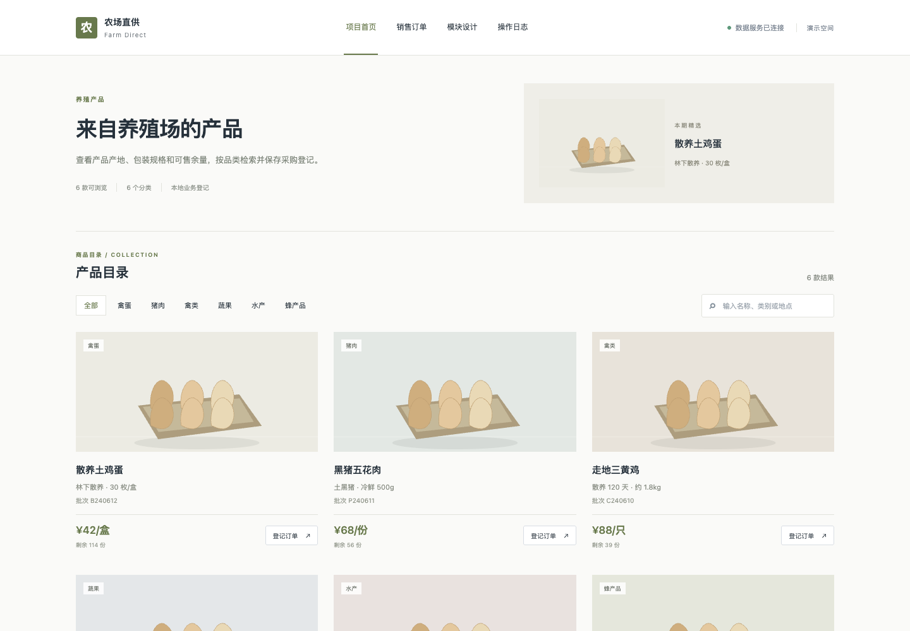

# 基于 SpringBoot 的小型养殖场产品销售系统的设计与实现

项目主题：小型养殖场产品销售系统（计算机毕业设计演示）。

## 技术栈

- 当前演示：Vue 3、Python、SQLite。
- 选题方案：Vue 3、Spring Boot、SQLite（部分技术尚未接入）。

## 项目功能

支持产品目录浏览、分类筛选、关键词搜索和登记订单，登记数据保存在本地数据库。

完整方案规划包括：商品档案、批次溯源、在线下单、预售拼单、冷链配送、客户管理、损耗登记、产销报表。部分功能尚待开发。

## 运行方式

在项目目录运行 `python3 backend/server.py`，然后访问 http://127.0.0.1:8000。

## 页面展示

## 微信联系

如果需要毕业设计，请扫描下方微信二维码联系。

